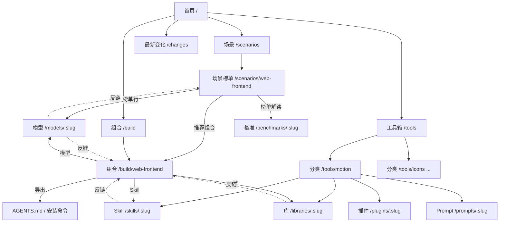

# vibecodingnav 信息架构 v7

> 版本说明：v7 把“场景”定义为**榜单**，新增**工具箱**（按用途分类，混合库 / Skill / 插件 / Prompt）与**组合**（做 X 任务页）。不含教程与广告。中英双语：英文在根路径，中文加 `/zh/` 前缀。

## 1. 三层结构

| 层 | 回答的问题 | 页面 |
|---|---|---|
| 组合（结论） | 我要做 X，整套用什么？ | `/build/<task>` |
| 场景（证据） | 做 X 哪个模型最好，依据是什么？ | `/scenarios/<slug>` |
| 工具箱（目录） | 某个用途有哪些库、Skill、插件、Prompt？ | `/tools/<category>` 及条目详情 |

模型页、基准页是被引用的叶子实体，自动汇总反向链接。

## 2. 顶部导航
`场景 · 模型 · 工具箱 · 组合 · 基准` ＋ ⌘K 搜索 ＋ 中 / EN ＋ 主题切换。

## 3. URL 方案

| 页面 | URL（英文） | 中文 |
|---|---|---|
| 首页 | `/` | `/zh` |
| 场景列表 | `/scenarios` | `/zh/scenarios` |
| 场景榜单 | `/scenarios/web-frontend` | `/zh/scenarios/web-frontend` |
| 模型 | `/models/claude-opus-5-5` | `/zh/models/claude-opus-5-5` |
| 基准（方法论，供多个场景共用） | `/benchmarks/lmarena-webdev` | 同上加前缀 |
| 工具箱总览 | `/tools` | |
| 工具分类 | `/tools/motion` | |
| 库 / 仓库详情 | `/libraries/phosphor-icons` | |
| Skill 详情 | `/skills/frontend-design` | |
| 插件（MCP / 编辑器插件） | `/plugins/motion-ai-kit`（MVP 可只在分类页展开，外链到源） | |
| Prompt | `/prompts/<slug>`（MVP 在分类页内联展示） | |
| 组合 | `/build`、`/build/web-frontend` | |

条目 URL 按类型分目录：同一个仓库若同时提供库和 Skill（如 GSAP 与 gsap-skills），作为两个条目、互相链接。

## 4. 页面类型与模块

### 首页（容器 1200px）
1. Hero：「按场景，选对模型与框架」＋一行“直接开工”链接到组合页
2. 场景榜单卡片（3 列 × 2 行，每卡前 5；无专项基准的场景显示编辑精选、不放分数）
3. 工具箱（4 列 × 2 行分类，每类 3 个条目，带类型标签 库 / Skill / 插件 / Prompt / 工具）
4. 最新变化（榜单、推荐、方法论）
5. 数据来源（更新日期，超过 90 天不作主要证据）

### 场景榜单页（960px）
面包屑 → 标题与说明 → 元信息（来源、榜单日期、票数 / 模型数、同步日期）→ 「推荐组合」入口条 → **完整榜单**（筛选：全部 / 闭源 / 开源许可 / 每家只看最高档；列：名次与排名区间、模型、分数与 95% CI、票数、价格、上下文；“初步”标记）→ **榜单解读**（测什么、怎么测、分数含义、注意、更新、来源）→ **为什么值得关注** → 其他场景。点模型进入模型页。

### 模型页（沿用 v4）
头部 → 三个关键分数 → 基准成绩表 → 选不选它 → 出现在这些场景 → **出现在这些组合（新增）** → 同级对比。

### 工具分类页
标题与说明 → 类型筛选（全部 / 库 / Skill / 插件 / Prompt）→ 条目列表（名称、类型、一句话用途、“适合”、许可与来源）→ 怎么选 → 出现在这些组合 → 其他分类。

### 库 / 仓库详情页
头部（许可、官网、仓库、版本、平台）→ 可视化特征（如图标字重）→ 安装与用法 → 为什么选 / 别用 / 注意 → 给 Agent 的一句话（AGENTS.md 片段）→ 同类 → 出现在这些组合。

### Skill 详情页
头部（作者、仓库、许可、格式、最近更新）→ 它让 Agent 做什么 → 安装（按 Agent 分）→ 兼容的 Agent → 什么时候别用 → 常和它一起用 / 出现在 / 来源。

### 组合页（做 X）
角色表（模型 / Skill / UI 组件 / 图标 / 动效 / 字体 / 设计稿；首选 ＋ 备选与何时换）→ 带走这一套（AGENTS.md ＋ 安装命令，可复制、下载）→ 这一套不适合 → 依据。

## 5. 内容类型与字段

```ts
Scenario   { slug, title, summary, benchmark: BenchmarkRef, filters?, editorPicks?: {modelSlug, reason}[], related: slug[] }
Benchmark  { slug, name, measures, method, scoreMeaning, caveats[], updateCadence, sourceUrl, methodUrl, asOf }
Result     { benchmark, modelSlug, rawId, effort?, rank, rankSpread?, score, ci?, votes?, price?, context?, preliminary?, asOf }
Model      { slug, name, vendor, license, context, price, agents[], summary, why[], whyNot[] }
ToolCategory { slug, title, summary, howToPick[] , items: itemSlug[] }       // 编辑排序
Item       { slug, type: 'library'|'skill'|'plugin'|'prompt'|'app', name, oneLiner, fitFor, license?, homepage, repo?,
             version?, install: {agent|pm, cmd}[], compatibleAgents?, whyPick, whenNot, caveats?, agentSnippet?, peers[], verifiedAt }
Build      { slug, scenario, title, summary, roles: { role, primary: Ref, alternatives: {ref, when}[] }[],
             agentsMd, installCmds, notFor: {case, goTo}[], updatedAt }
// Build.roles 中 role='model' 的 primary / alternatives 可声明为 {from: scenario, pick: 'top'|'value'|'open'}，构建时从榜单计算
```

## 6. 交叉链接规则
- 场景 → 模型（榜单行）、组合（入口条）；模型 → 场景、组合（自动反链）。
- 工具分类 → 条目；条目 → 同类、组合（自动反链）；Skill ↔ 对应库（如 gsap-skills ↔ GSAP）。
- 组合只引用、不复制：模型行来自场景榜单，工具行引用 Item；任何被引用实体更新，组合页随构建刷新，并写入「最新变化」。
- 所有结论附来源和日期；超过 90 天未更新的基准降级显示。

## 7. MVP 范围
- 场景 6 个：Web 前端（LMArena WebDev）、Android App（Android Bench 1.0）、CLI / DevOps（Terminal-Bench 4.0）、重构与迁移（Android Bench 2.0 长程）、开源模型做前端（WebDev 开源许可筛选）、iOS（编辑精选）。
- 工具分类 8 个：UI 组件、图标、动效、字体、图表、表单与校验、设计还原、项目规则；约 30 个条目。
- 组合 3 个：做 Web 前端、做一个 Android App、写 CLI 与脚本。
- 双语：先中文全量，英文同步结构与条目一句话。

## 8. 站点地图


